# Sistema de Reservas - Gestion de Servicios y Reservas

- **Nombre completo:** Juan Felix Maria Baldera
- **Matricula:** 2013-0680
- **Correo:** Juan_maria1@ucne.edu.do
- **URL API Endpoint:** https://capa1-production.up.railway.app

## Endpoints

### Autenticacion
- `POST /auth/registro` — Publico (Crear cuenta)
- `POST /auth/login` — Publico (Iniciar sesion)

### Servicios
- `GET /servicios` — Autenticado (Listar servicios)
- `GET /servicios/:id` — Autenticado (Detalle de servicio)
- `POST /servicios` — Solo admin (Crear servicio)
- `PUT /servicios/:id` — Solo admin (Editar servicio)
- `DELETE /servicios/:id` — Solo admin (Eliminar servicio)

### Reservas
- `POST /reservas` — Cliente (Crear una reserva)
- `GET /reservas/mis-reservas` — Cliente (Ver mis reservas)
- `GET /reservas` — Solo admin (Ver todas las reservas)
- `PUT /reservas/:id/estado` — Solo admin (Cambiar estado a completada)
- `DELETE /reservas/:id` — Cliente (Cancelar mi reserva pendiente)

## Capturas de Pantalla

### Pantallas Principales

| Inicio de Sesion | Inicio / Perfil | Servicios (Admin) |
| :---: | :---: | :---: |
| 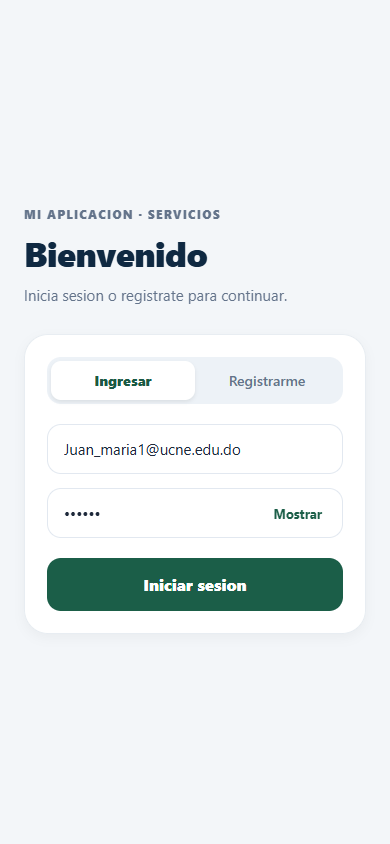 | 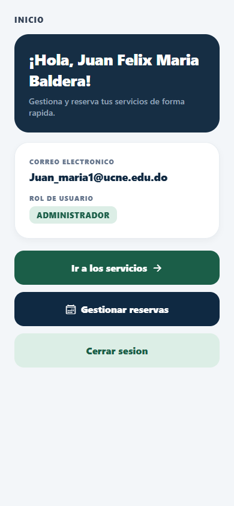 | 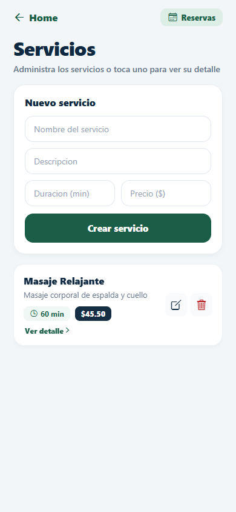 |

### Gestion de Servicios

| Registro de Usuario | Editar Servicio | Confirmacion de Eliminacion | Vista de Cliente |
| :---: | :---: | :---: | :---: |
| 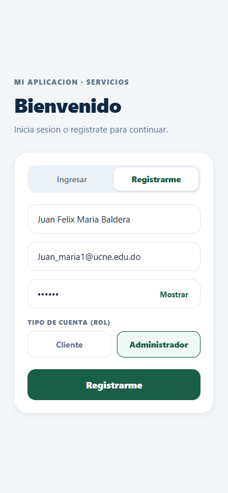 | 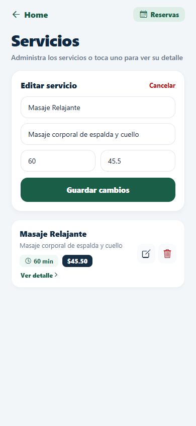 | 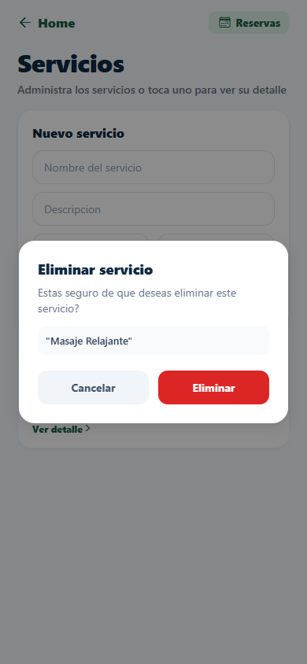 | 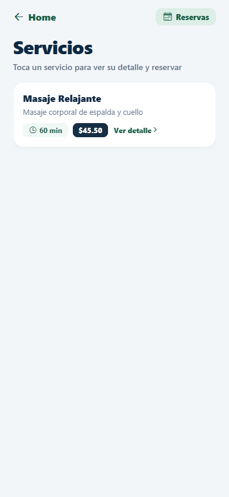 |

### Flujo de Reservas

| Detalle de Servicio | Nueva Reserva | Mis Reservas (Cliente) | Cancelar Reserva | Todas las Reservas (Admin) |
| :---: | :---: | :---: | :---: | :---: |
| 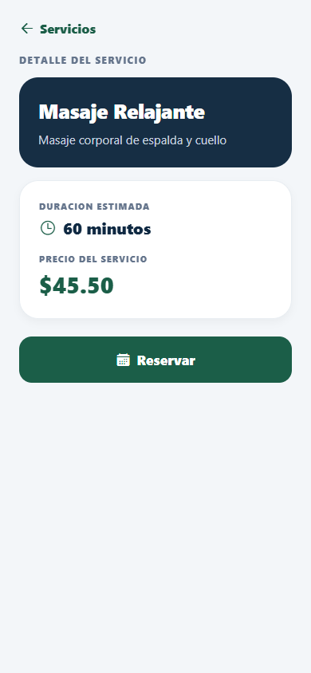 | 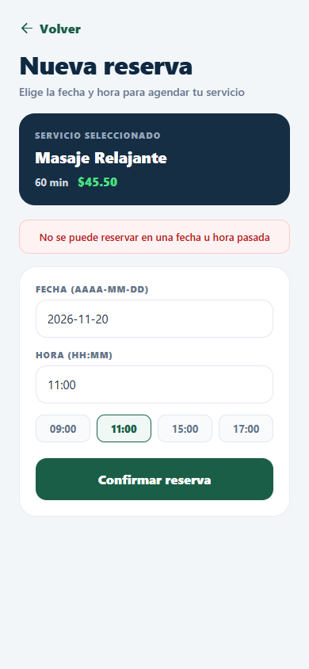 | 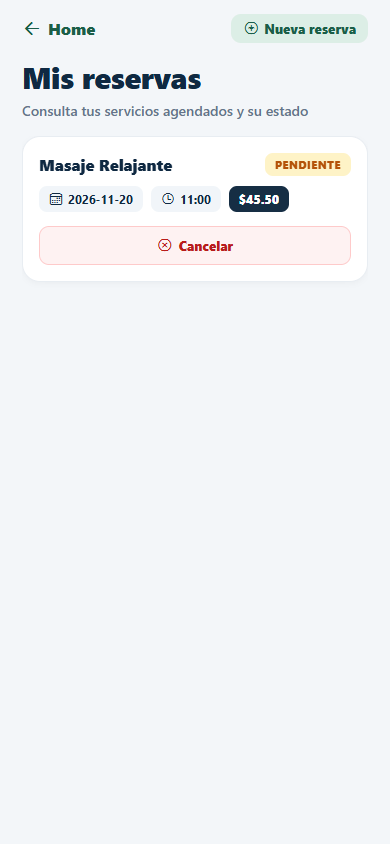 | 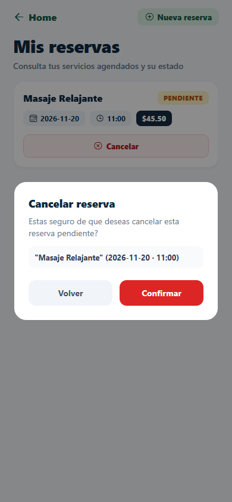 | 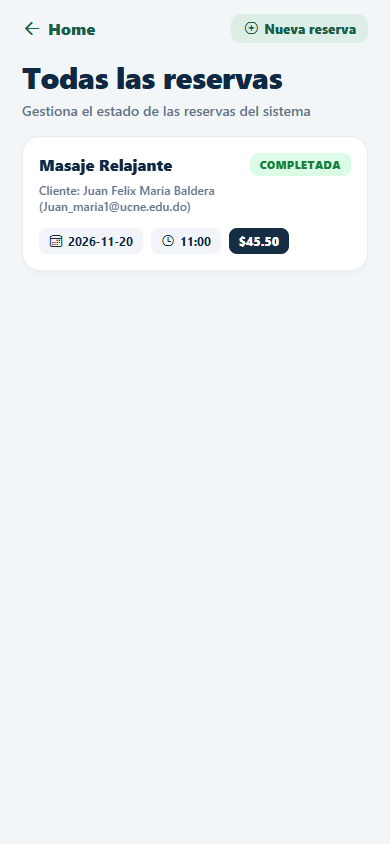 |
